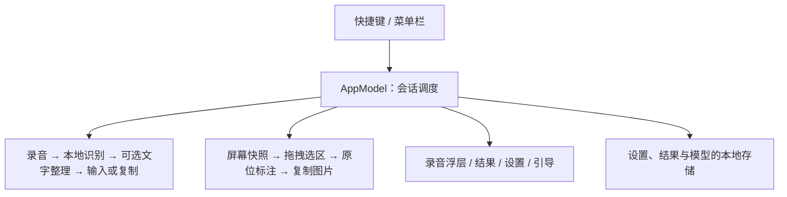

# Tess 项目架构与目录地图

核对日期：2026-10-24。根目录 `/Users/caine/Documents/Project/Faster` 沿用早期 Faster 项目名，当前产品名为 Tess；本轮保留根目录名称，已按功能迁移文档与本机产物，GitHub 仓库名沿用 Faster。

## 当前项目是什么

一个原生 macOS 菜单栏应用，面向 Apple Silicon、macOS 26+。SwiftUI 负责界面，AppKit 负责窗口、菜单栏和系统交互；`AppModel` 集中调度会话和各服务。没有自建 Tess 账号服务器或云端中转。语音识别在本机运行；用户启用文字整理时，文字直接发给其配置的外部服务。

## 目录各管什么

| 目录／文件 | 作用 | 日常是否需要关注 |
| --- | --- | --- |
| `README.md` | 当前状态、使用说明和文档入口 | 每次开始先看 |
| `AGENTS.md` | 后续代理的项目工作约定 | 按其中指向的流程执行 |
| `docs/` | 固定流程、架构和目录说明 | 维护长期规则时使用 |
| `Tess/` | 当前应用工程，含源码、资源、独立检查和实际编译的第三方代码 | 主要开发区域 |
| `scripts/` | 构建、归档、打包、图标生成和各项检查脚本 | 按本轮任务选用 |
| `assets/branding/` | 品牌源素材；当前选定方案为 `tess-spirit/` | 修改品牌时使用 |
| `evidence/` | 按轮次保存的日志、截图、人工反馈、源码及配置快照 | 查证具体构建时使用，不属于应用源码 |
| `upstream/` | Talkify 与 speech-swift 的上游参考副本，保留在本机 | 研究来源时使用，不参与 GitHub 同步 |
| `.build/` | 按 cache/local/releases/models/verification/history/tools/logs 分组 | 各类独立存放，见下方清单 |
| `dist/` | 按版本／build 分组的交付输出；当前仅有旧 build 14 | 不上传 GitHub，不代表最新安装版 |
| `docs/product/` | BRD、PRD | 查产品依据 |
| `docs/releases/` | 安装计划、发布进度与验收 | 记录交付过程 |
| `docs/history/` | 优化、品牌及旧 README 等历史材料 | 旧状态有时间边界 |

## 应用工程内部

工程入口：`Tess/Tess.xcodeproj`。这是单个 Tess App target；当前 Swift 检查程序由脚本独立编译运行，不是另一个应用产品。

| 模块 | 文件／目录 | 职责 |
| --- | --- | --- |
| 应用与窗口 | `TessApp.swift` | 启动、菜单栏、设置／结果窗口、截图编辑层、应用生命周期 |
| 会话协调 | `AppModel.swift` | 录音／识别／整理／交付／截图状态，取消和重试，调用界面与服务 |
| 快捷键 | `HotkeyService.swift` | Fn 与组合键、按下／释放、取消及会话中断后的恢复 |
| 录音 | `AudioRecorder.swift`、`AudioLevelMeter.swift` | 麦克风、音频缓冲、时长和音量 |
| 本地识别 | `ASRService.swift` | Qwen／Whisper 的模型管理、准备、中间与最终识别 |
| 文字整理 | `TextService.swift`、`APIConfiguration.swift` | 原文／轻量整理／列表／润色，外部 API 配置和密钥引用 |
| 外部输入 | `DeliveryService.swift` | 识别输入目标、粘贴、剪贴板回退及微信窗口兼容保护 |
| 原位截图 | `CaptureService.swift`、`ScreenshotSelection.swift`、`ScreenshotEditorView.swift` | ScreenCaptureKit 快照、选区坐标、调暗层、标注、图片存储及复制 |
| 本地存储 | `LocalStore.swift` | 设置与结果文件、写入恢复及损坏文件的恢复副本 |
| 界面 | `SettingsView.swift`、`OnboardingView.swift`、`ResultView.swift`、`HUDView.swift` 等 | 设置、引导、结果与录音浮层 |
| 品牌与组件 | `Sources/Design/`、`TessMenuBarIcon.swift` | 颜色、精灵／字标、菜单栏及通用设置组件 |
| 内部诊断 | `HUDPreview.swift`、`ASRBenchmark.swift` | 内部检查入口，正式发行需确认相应入口未启用 |
| 检查 | `Tess/Checks/` | 交互、存储、快捷键、截图、输入等独立检查程序 |
| 随包资源 | `Tess/Resources/` | 图标、精灵图片、字体、帮助和第三方许可 |
| 本地依赖包 | `Tess/Vendor/SpeechSwift/` | 实际参与编译的 AudioCommon、MLXCommon、Qwen3ASR、WhisperASR 等源码 |

实际依赖链：Xcode 工程 → `Tess/Vendor/SpeechSwift/Package.swift` → MLX Swift、Swift Transformers 等 Swift Package 依赖。解析后的检出副本位于 `.build/cache/SourcePackages/`。`upstream/` 只是保留的参考来源，不应误把它的源码改动当作 Tess 已接入。

品牌源素材在 `assets/branding/tess-spirit/`，`scripts/make-icon.swift` 将相应素材生成到 `Tess/Resources/`。基础模型不放进源码资源目录，而是在正式归档时从 `.build/models/qwenSmall/` 嵌入 App 的 `Contents/Resources/BaseSpeechModel.tessmodel/`。

## 用户数据不在项目目录里

正常运行的数据目录为 `/Users/caine/Library/Application Support/Tess/`：

- `preferences.json`：偏好、快捷键及引导状态。
- `recent.json`、`draft.json`：最近结果和草稿。
- `api-configurations.json`：文字服务配置；API Key 本身在 macOS Keychain。
- `Models/`：用户主动下载的模型；有效下载模型优先，否则可使用随包基础模型。
- `Captures/`：选区图片暂存；`Recovery/`：存储恢复副本。

已安装应用为 `/Applications/Tess.app`。项目候选、归档、正式 DMG 和用户数据是不同位置，更新安装不等于重置用户数据。

## 本机产物与回退

| 位置 | 内容 |
| --- | --- |
| `.build/local/0.2.0-build25/Tess.app` | 与当前本机版本对应的完整候选 |
| `.build/local/0.2.0-build24/Tess.app` | 紧邻回退 |
| `.build/local/0.2.0-build21/Tess.app` | 用户曾确认整体可用的早期截图版 |
| `.build/releases/0.2.0-build14/` 至 `build17/` | 历史正式归档及相应公证导出，不能概括为都已公证 |
| `.build/history/` | 其余旧候选、备份、源码快照与旧打包暂存，保留未删 |
| `.build/cache/` | 当前编译与依赖缓存；迁移前预编译缓存在 `legacy/`，因包含绝对路径而单独留存 |
| `.build/models/` | 经校验的基础模型权重 |
| `.build/verification/` | 隔离检查、验收和诊断资料 |
| `.build/tools/release/` | 历史发行工具；当前公证配置已纳入 `scripts/release/` |
| `.build/logs/` | 历史构建与启动日志 |
| `dist/0.2.0-build14/` | 旧 App、DMG、摘要，有已知输入故障；本轮未生成新正式包 |

项目已建立 Git main 分支和私有 GitHub 远端。整理前源码标签 `local-build25-baseline` 可用于查看当时的代码与目录；Git 不包含本机二进制和原始验收资料。GitHub 同步源码、必要品牌资源、文档、脚本、锁定依赖和公开校验清单。

原始 `evidence/` 可能包含配置快照及桌面材料，因此仅在本机保留。上游参考、缓存、模型和安装包也不上传。整理范围及旧路径定位见 [整理记录](workspace-organization.md) 和 [完整路径映射](workspace-layout.json)。

## 版本核对快照

2026-10-24 核对：源码与本机应用为 `0.2.0 build 25`；`dist/0.2.0-build14/Tess.app` 与同目录旧 DMG 仍对应 build 14。最新原位截图的人工验收尚无确认记录。本文件仅解释结构，后续版本状态以 README 最新核对和对应验收证据为准。
