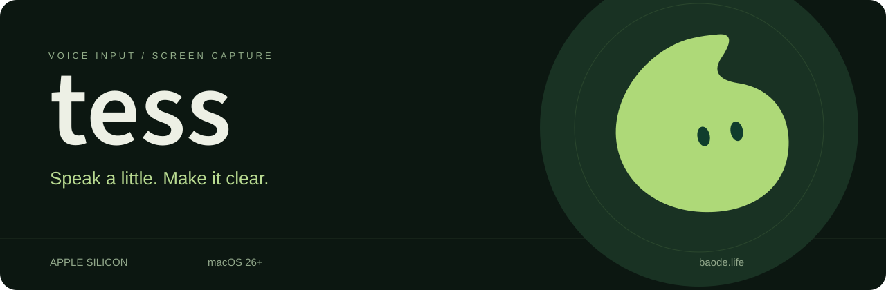

<p align="center"></p>

<div align="center">

# Tess 苔丝

**说出来，写下来。**

Mac 上的本地语音输入与原位截图标注工具。

[**↓ 下载 Mac 版**](https://github.com/cainebaode/Tess/releases/latest)　·　[产品网站](https://tess.baode.life/)　·　[使用帮助](https://tess.baode.life/help/)　·　[隐私说明](https://tess.baode.life/privacy/)

Apple Silicon · macOS 26 或更新版本

</div>

---

### 一个常驻菜单栏的小帮手

| 说话，变成文字 | 截图，标出重点 |
| :--- | :--- |
| 把光标放到输入框，按住 Fn 说话，松开结束。也可以轻点开始，再点结束。 | 拖出选区，在原位置画方框、圆圈或加文字，完成后复制或保存 PNG。 |
| 基础识别在本机完成，安装包包含基础离线模型。 | 支持颜色切换、撤销和取消；截图不发送给文字模型。 |

想进一步整理文字时，可以自行配置文字服务，选择轻量整理、列表或润色。基础听写无需 API Key；文字服务费用由对应服务商收取。

### 下载与安装

1. 打开 [最新版本](https://github.com/cainebaode/Tess/releases/latest)，下载 **`.dmg` 安装包**。
2. 打开 DMG，把 **Tess 拖到「应用程序」**，从那里启动。
3. 按引导允许麦克风和辅助功能，确认模型就绪，试说一句。截图权限在使用截图时申请。

> **请下载 DMG。** GitHub 自动生成的 **Source code (zip / tar.gz)** 不包含应用。

更新前退出 Tess，再用新版覆盖安装；设置、用户模型和引导进度独立保存。当前版本采用手动更新。

### 使用时，留意这几件事

- 显示「已复制」时，回到输入框按 **⌘V**。Tess **不会自动发送消息**。
- 微信采用窗口级兼容输入：先点击聊天输入框，再录音；中途点击、打字或切换应用后，结果改为复制。不要用于密码输入。
- 仅支持 **Apple Silicon 与 macOS 26+**；暂不提供 Intel Mac 或 Windows 版。
- GitHub 下载速度取决于网络。如下载中断，可以重新下载后核对校验值。

### 版本与文件校验

每个版本提供 DMG 和对应的 **`.sha256`** 文件，版本说明列出系统要求、更新内容、大小与校验值。App 与 DMG 使用 Developer ID 签名并完成 Apple 公证。

在终端运行 `shasum -a 256` 后，将下载的 DMG 拖入终端、按回车；输出应与同版本的校验文件一致。

### 从源码构建

源码、问题反馈和正式版本都在这个 Tess 仓库维护。需要 Apple Silicon Mac、macOS 26+、Xcode 26+ 及对应 Metal 编译组件。

```sh
git clone https://github.com/cainebaode/Tess.git
cd Tess
./scripts/build.sh
```

开发产物位于 `.build/local/<version>-build<build>/development/`，默认使用临时签名；开发构建不包含正式包内的离线模型。开发、正式打包和模型准备见 [开发说明](https://github.com/cainebaode/Tess/blob/main/docs/development.md) 与 [发行配置](https://github.com/cainebaode/Tess/blob/main/scripts/release/README.md)。

第三方代码、字体和模型的许可与来源保留在 [Tess/Resources](https://github.com/cainebaode/Tess/tree/main/Tess/Resources) 和 Vendor 对应目录。

### 帮助与反馈

[使用帮助](https://tess.baode.life/help/) · [隐私说明](https://tess.baode.life/privacy/) · [邮件联系作者](mailto:cainetaiwan@gmail.com?subject=Tess%20Support)

反馈时提供 Tess 版本、macOS 版本和问题描述即可。请不要提交 API Key、私人录音或不必要的敏感截图。

---

<div align="center">

[饱得自家 · baode.life](https://baode.life/)　—　从自己的需要出发。

<sub>本仓库包含 Tess 源码、构建说明与正式版本。第三方许可随源码和应用提供。</sub>

</div>
